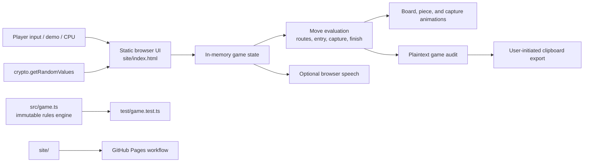

# Dhayam

[](https://nodejs.org/)
[](#test-plan)
[](#deployment)
[](LICENSE)

Dhayam is a static browser board game for local pass-and-play or one human against 1–5 computer opponents. It is a playable 7×7 house variant with six numbered pieces per player, guided play, narrated commentary, and an exportable game audit.

## Quick start

Requirements: Node.js 22.18 or newer.

```sh
npm test
python3 -m http.server 8000 --directory site
```

Open `http://localhost:8000/` from the machine that starts the local server.

## Player experience

- Play locally with 2–4 people, or play solo against 1–5 computer players.
- Follow numbered pieces through square-by-square movement, capture animations, and the family table’s Waiting, On board, and Home lists.
- Use the board or the explicit **Move selected piece** control for every legal move.
- Run the guided demo with pause, restart, optional speech, 0.5×–2× speed, or silent 3× Super speed.
- Copy a plaintext audit with rolls, bonus-chain decisions, moves, captures, passes, winner, and board snapshots.

## Rules implemented

- Roll a `1` to bring a piece from Waiting onto the board.
- Pieces follow a 44-position route. A player must make a capture before moving into the inner track.
- Floral squares are safe. Landing on one opponent on an unsafe square captures it and returns that numbered piece to Waiting. Landing on multiple opponents is illegal.
- A piece reaches the center only by exact count. The first player to bring all six pieces home wins immediately and the match stops.
- Two virtual dice independently produce faces `0`–`3`; double zero is displayed as `12`. Middle move values are intentionally more frequent, as with two fair dice.
- `1`, `5`, `6`, and `12` are special. The first special roll earns another throw; every bonus already earned that turn halves the chance that a later special value extends it. Dice values themselves are never weighted.

## Architecture



The browser UI is self-contained so it can run on static hosting without a backend. `src/game.ts` is a dependency-free, immutable TypeScript rules engine used by the Node test suite. The UI currently maintains matching browser-side rules while it is migrated to consume that engine directly. This separation keeps a future authoritative multiplayer service possible.

## Design decisions

| Decision                         | Why                                                                                                                                              |
| -------------------------------- | ------------------------------------------------------------------------------------------------------------------------------------------------ |
| Static hosting                   | No accounts, database, or application server are required.                                                                                       |
| `crypto.getRandomValues` dice    | Browser cryptographic randomness avoids predictable pseudo-random rolls. `% 4` is exact because the 32-bit range divides evenly into four faces. |
| Diminishing bonus chains         | Special dice remain fair while unusually long turns become progressively less likely.                                                            |
| Numbered pieces and family table | Piece numbers remove ambiguity in stacks; Waiting, On board, and Home make state visible.                                                        |
| Capture animation before removal | The game names the losing player and piece, animates it away, then returns it to Waiting.                                                        |
| Responsive dice-first layout    | Dice scale up on laptop and tablet screens; secondary controls compact, and the layout becomes a single-column flow on phones.                  |
| Plaintext audit                  | Supports fairness and stuck-game analysis without sending data to a server.                                                                      |
| First completed set wins         | The first player to finish all six pieces is announced immediately; later turns are disabled.                                                    |
| Intro preference cookie          | The welcome screen is shown by default and a local cookie records an opt-out for future launches.                                                |

## Threat model and privacy

This is a local casual game, not an anti-cheat or competitive multiplayer system.

| Concern                        | Current treatment                                                                                                  | Limit                                                                                   |
| ------------------------------ | ------------------------------------------------------------------------------------------------------------------ | --------------------------------------------------------------------------------------- |
| Loaded or predictable dice     | Uses `crypto.getRandomValues`; audit records outcomes and bonus decisions.                                         | Browser developer tools or malicious extensions can change local state.                 |
| Bonus-chain fairness           | Same diminishing rule for every player; audit includes depth, chance, and draw.                                    | This is a house-rule policy, not a claim of historical rules.                           |
| Audit integrity                | Ordered events, timestamps, player IDs, piece numbers, and board snapshots are exported.                           | Browser-generated audits are not signed or tamper-proof.                                |
| Player privacy                 | No account, telemetry, analytics, or game data is sent to an application server.                                   | Users choose whether to copy or share audits, which can include player names and moves. |
| Hosted-code integrity          | GitHub Pages serves committed static files over HTTPS.                                                             | Anyone who can change the repository or browser environment can alter the game.         |
| Speech, clipboard, and cookies | Speech is optional, clipboard writes require user action, and the intro cookie only stores a dismissal preference. | Browser/OS support and permissions vary.                                                |

Do not use this prototype as an authoritative tournament record or security boundary.

## Test plan

Run the automated rules-engine checks:

```sh
npm test
npm run test:coverage
```

The unit suite covers seating, rotational routes, face-to-value mapping, entry, capture prerequisites, safe squares, illegal multi-opponent landings, immutable capture application, exact finishing, and combined-roll allocation.

Before publishing a UI change, verify in a browser:

1. Roll and move a legal piece; confirm every square is visibly traversed.
2. Capture an opponent; confirm the named numbered piece animates away and moves from On board to Waiting.
3. Finish a sixth piece; confirm the winner is announced and no further turn is available.
4. Run the guided demo at 0.5×, 1×, 2×, and Super speed; confirm Super speed disables audio while preserving readable movement.
5. Copy an audit and inspect rolls, bonus-chain fields, move source, captures, passes, and winner event.
6. Run a solo match with a computer player and confirm computer turns wait for animation and narration.
7. Clear the `dhayam_intro_seen` cookie and confirm the welcome splash returns; select its opt-out checkbox and confirm it stays hidden after reload.
8. Check 1440px, 1024px, 768px, and 390px widths for visible dice, usable controls, and no horizontal page overflow.

## Deployment

[.github/workflows/pages.yml](.github/workflows/pages.yml) publishes `site/` on each push to `main`.

1. Open **Settings → Pages** and select **GitHub Actions** as the source.
2. Ensure GitHub Actions are allowed under **Settings → Actions → General**.
3. Push to `main` and inspect the **Deploy GitHub Pages** workflow.
4. After success, open `https://<owner>.github.io/<repository>/`.

GitHub Pages for a private repository depends on the owner’s GitHub plan. If Pages is unavailable, make the repository public or deploy the static `site/` directory to another static host.

## Repository layout

```text
site/                         Static game UI and browser behavior
src/game.ts                   Immutable TypeScript rules engine
test/game.test.ts             Node test suite
.github/workflows/pages.yml   GitHub Pages deployment workflow
```

## License

[MIT License](LICENSE)
