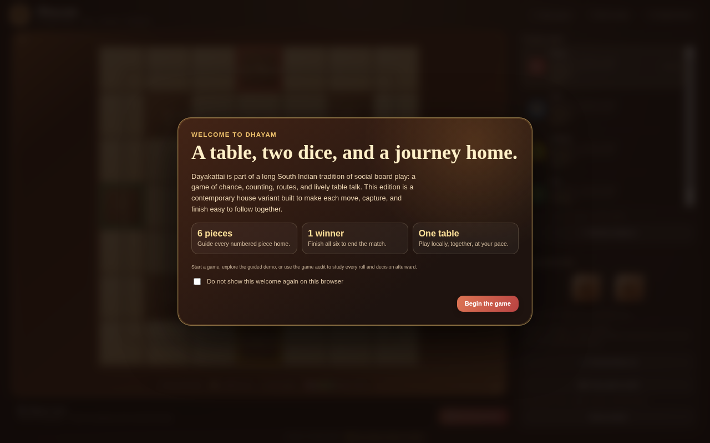
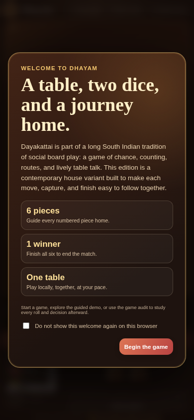

# Dhayam

[](https://github.com/sethusrinivasan/dhayam/actions/workflows/pages.yml)
[](https://github.com/sethusrinivasan/dhayam/actions/workflows/test.yml)
[](https://sethusrinivasan.github.io/dhayam/)
[](LICENSE)

A static, Dayakattai-inspired traditional board game for local pass-and-play or solo play against 1–5 computer AI opponents. Built with clean separation of concerns, modular vanilla web technologies, authentic 3D dice physics, voice commentary, animated captures, and exportable game audit logging.

🎮 **Live Game:** [https://sethusrinivasan.github.io/dhayam/](https://sethusrinivasan.github.io/dhayam/)

---

## 📸 Screenshots

### Tabletop Desktop View

*7×7 board with flowing SVG path overlay, 3D Dayakattai dice, numbered pieces, and live family table.*

### Responsive Mobile View

*Fully responsive layout optimized for touch interaction on phones and tablets.*

---

## ⚡ Quick Start

### 1. Launch Locally
Start the local server with one command (uses Python's built-in HTTP server, zero dependencies required):

```sh
./start.sh
# or: ./scripts/start.sh
```

Then open `http://localhost:8000/` in your browser.

### 2. Run Tests
Verify file integrity, headless Chrome DOM rendering, and game rules:

```sh
./test.sh
# or: ./scripts/test.sh
```

If Node.js is installed, you can also run:
```sh
npm test
npm run test:coverage
```

---

## 🏛️ Architecture & Separation of Concerns

The codebase is strictly organized for human readability, maintainability, and clean git diff tracking:

```
dhayam/
├── start.sh                       # Quick launcher for local development server
├── test.sh                        # Automated test runner and verification suite
├── scripts/
│   ├── start.sh                   # Self-contained Python HTTP server launcher
│   └── test.sh                    # Headless browser + rules engine validation suite
├── site/                          # Static web application published to GitHub Pages
│   ├── index.html                 # Clean semantic HTML markup (~320 lines)
│   ├── board-definition-v1-candidate.json # Formal 7x7 board graph specification
│   ├── css/                       # Modular stylesheets (isolated concerns)
│   │   ├── base.css               # Typography, CSS variables, and layout shell
│   │   ├── board.css              # 7x7 grid, cell states, tokens, path flow SVG
│   │   ├── dice.css               # 3D cuboidal dice transforms, faces, and rolling animations
│   │   ├── controls.css           # Turn status bar, action buttons, chips, demobar
│   │   ├── panels.css             # Family table, player cards, avatars, metadata
│   │   ├── modals.css             # Welcome splash screen, dialogs, player rename editor
│   │   └── responsive.css         # Tablet (860px), mobile (520px), and reduced-motion
│   └── js/                        # Modular JavaScript (focused single-responsibility modules)
│       ├── config.js              # Board geometry constants, 44-step circuit rotation, timing
│       ├── state.js               # Global match state variables and text sanitization helpers
│       ├── audio.js               # Browser SpeechSynthesis commentary and voice persona hints
│       ├── dice.js                # Cryptographic unbiased random dice & 3D CSS tumbling
│       ├── audit.js               # Event recorder, board snapshots, and clipboard export
│       ├── engine.js              # Move candidate validation, safe squares, and capture rules
│       ├── turn.js                # Turn lifecycle, animated piece stepping, and AI scheduling
│       ├── ui.js                  # DOM renderer (cells, numbered tokens, chips, dropdowns)
│       ├── demo.js                # Guided demo controller, speech sync, speed controls
│       └── app.js                 # Modal managers, player editor, keyboard nav, bootstrap
├── src/
│   └── game.ts                    # Immutable TypeScript rules engine (for headless testing)
└── test/
    └── game.test.ts               # Unit test suite for game rules and invariants
```

---

## 📜 Game Rules & Features

1. **Dayakattai Dice**: Two long dice roll values 0, 1, 2, or 3. Double-zero counts as **12** (*Pannirandu*). Rolling **1 (*Dhayam*), 5, 6, or 12** grants an extra bonus roll in a chain.
2. **Entering Reserve Pawns**: All 6 pieces per player begin in reserve. A roll of **1 (*Dhayam*)** is required to bring a pawn onto your home gate (`A4`, `D7`, `G4`, `D1`).
3. **Safe Squares (*Malai* / ✿)**: The 8 floral squares are protected sanctuaries. Opponents on safe squares cannot be captured and coexist peacefully.
4. **Captures (*Vettu*)**: Landing on a single unprotected opponent pawn on an unsafe square captures it, sending it back to reserve and unlocking the inner track. Multi-opponent stacks cannot be captured.
5. **Inner Track & Home (*Pazham* / ✺)**: Once a player earns at least one capture, their pieces may advance into the inner circuit and approach center lotus square **D4**.
6. **Exact Finish**: Pawns must reach **D4** by exact roll count. First player to bring all 6 pawns home wins!
7. **Game Audit**: Click **📋 Copy game audit** at any time to export a complete structured log of every roll, move, capture, pass, and board state snapshot.

---

## 🚀 Deployment

The repository is configured for automatic GitHub Pages deployment using `.github/workflows/pages.yml`.

- Every push to the `main` branch automatically uploads and deploys `site/` to GitHub Pages.
- In your repository settings: **Settings** → **Pages** → select **GitHub Actions** as the source.
- Live URL: `https://<username>.github.io/<repository-name>/`

---

## 📄 License

[MIT](LICENSE)
