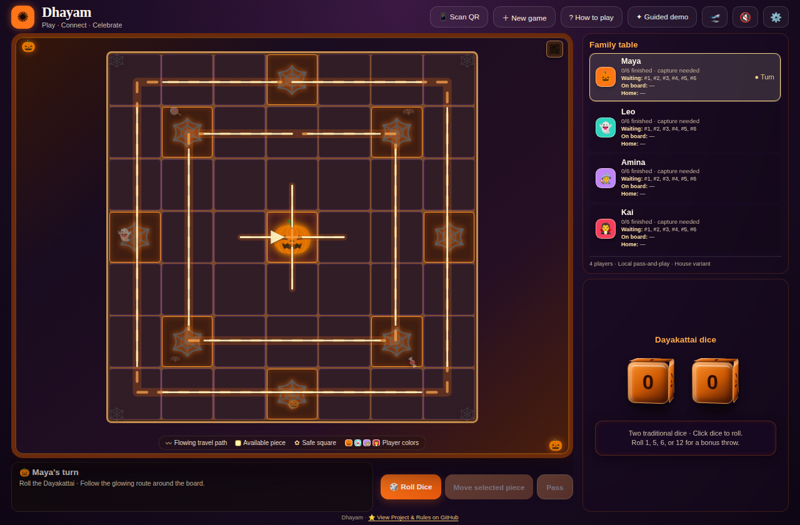
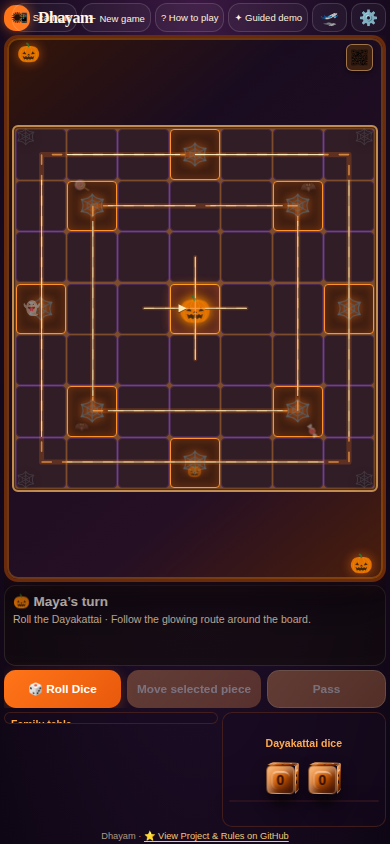

# ✺ Dhayam (தாயக்கட்டை)

[](https://dhayam.cancun.workers.dev)
[](https://sethusrinivasan.github.io/dhayam/)
[](https://github.com/sethusrinivasan/dhayam/actions)
[](#)
[](#)
[](#)
[](LICENSE)

An authentic, modern web rendition of **Dhayam** (தாயக்கட்டை), the ancient Tamil race-and-capture strategy board game. Built for cross-device real-time online multiplayer, pass-and-play family tabletop, or solo play against intelligent computer opponents.

Features physical 3D cuboidal brass dice tumbling, smooth animated pawn stepping, dynamic QR code instant-join, family table scoring, natural voice commentary, and progressive golden lighting as pawns advance toward the sacred center.

🎮 **Play Live on Cloudflare Edge:** [https://dhayam.cancun.workers.dev](https://dhayam.cancun.workers.dev)  
🌐 **GitHub Pages Mirror:** [https://sethusrinivasan.github.io/dhayam/](https://sethusrinivasan.github.io/dhayam/)

---

## 📸 Screenshots

### Tabletop Desktop View

*Authentic 7×7 board with flowing rotational SVG circuit, 3D தாயக்கட்டை brass dice, real-time multiplayer status, and live family table scoring.*

### Responsive Mobile & Tablet View

*Touch-optimized interface with camera QR code instant-join, single-tap dice rolling, and floating reaction banter.*

---

## ✨ Key Features

* **⚡ Real-Time Online Multiplayer**: Powered by Cloudflare Durable Objects with WebSocket Hibernation. Sub-50ms latency with automatic session recovery when switching tabs.
* **🎲 Synchronized 3D Dice Physics**: Two long cuboidal brass dice tumble and bounce across every connected player's screen simultaneously in real-time 3D CSS.
* **♟️ Smooth Animated Pawn Movement**: Pawns step square-by-square along the golden circuit with capture badges and slow return animations to the family reserve.
* **🌟 Progressive Track Illumination**: Pawns glow brighter as they enter the second inner square, radiate when reaching the approach cross, and shine with golden brilliance at the center goal.
* **📱 Dynamic QR Code Instant-Join**: Host displays a crisp QR code on laptop or TV; friends scan with their phone camera to auto-join and pick an open slot.
* **💬 Floating Reaction Banter**: Quick emoji reactions (🎉, 👏, 🔥, 😂, 🎲, 😱) float across the board in real time.
* **🤖 Smart Solo Computer Play**: Solo play vs 1 to 3 heuristic computer opponents balancing captures, safety, and team progression with speech commentary.
* **🎙️ Voice Commentary**: Natural speech synthesis announces rolls (*"தாயம்!"*, *"பன்னிரண்டு!"*), captures (*"வெட்டு!"*), and milestones without premature cut-offs.
* **⭐ Family Table Scoring**: Live progress tracker awarding points for board completion (+1 pt/sq), capture achievements (+50 pts), and home finishes (+100 pts).

---

## 📜 How to Play Dhayam

Dhayam is a strategic race between 2 to 4 players across a 7×7 grid of 44 positions.

1. **The Dice (தாயக்கட்டை)**: Two long 4-sided brass dice roll values 0, 1, 2, or 3.
   - Double zero ($0+0$) counts as **12 (பன்னிரண்டு)**.
   - Rolling **1 (தாயம்)**, **5**, **6**, or **12** awards an extra bonus roll in a chain.
2. **Entering the Board**: All 6 pieces per player begin in reserve. A roll of **1 (தாயம்)** is required to bring a pawn out of reserve and onto your home gate (`A4`, `D7`, `G4`, `D1`).
3. **Safe Sanctuaries (மலை / ✿)**: The 8 floral squares are protected sanctuaries. Opponents on safe squares co-exist peacefully and cannot be captured.
4. **Captures (வெட்டு)**: Landing on an unprotected opponent pawn on an unsafe square captures it, sending it back to reserve. **Earning at least one capture is mandatory to unlock the inner circuit!**
5. **Inner Track & Lotus Center (பழம் / ✺)**: Once a player achieves a capture, their pieces turn into the inner ring and approach the sacred center square **D4**.
6. **Winning the Game**: Pawns must reach the center **D4** by exact roll count. The first player to bring all 6 pawns home wins!

---

## 🚀 Quick Start

### 1. Launch Locally (Zero Dependencies)
Run with Python's built-in HTTP server:
```sh
./start.sh
# or: python3 -m http.server 8000 --directory site
```
Open `http://localhost:8000/` in any browser.

### 2. Run Local Cloudflare Dev Server
```sh
npx wrangler dev
```
Open `http://localhost:8787/` to test Cloudflare Durable Objects and WebSockets locally.

### 3. Run Automated Tests
```sh
npm test              # Runs 48 unit, regression, and MCP tests
./test.sh             # Full 12-point verification suite
```

---

## 📚 Documentation & Technical Guides

* 🏛️ **[Architecture & Design](docs/architecture.md)** — Modular design, zero runtime dependencies, and Cloudflare Edge Durable Objects.
* 🔄 **[Dev, Test, Debug & Staging Workflow](docs/development-workflow.md)** — Full development cycle, Flight Recorder black box debugging, automated staging gate, and production promotion.
* ☁️ **[Hosting & Deployment](docs/cloudflare-deployment.md)** — Zero-cost Cloudflare Free Tier hosting setup.
* 🛡️ **[OWASP Top 20 Security Evaluation](docs/owasp-top-20-security-evaluation.md)** — Comprehensive 2026 security audit, XSS defense, rate limiting, and threat model.
* 🤖 **[MCP Integration Guide](docs/mcp-evaluation.md)** — Model Context Protocol endpoints for autonomous AI matches.
* 📋 **[Project Roadmap & Gaps](PROJECTS.md)** — Multiplayer lobbies, reconnection resilience, and Tamil/Hindi/Telugu i18n localization.
* 📖 **[Dhayam Wiki](wiki/)** — Strategy guides, rules variations, and developer reference.

---

## 📄 License

Distributed under the [MIT License](LICENSE).
