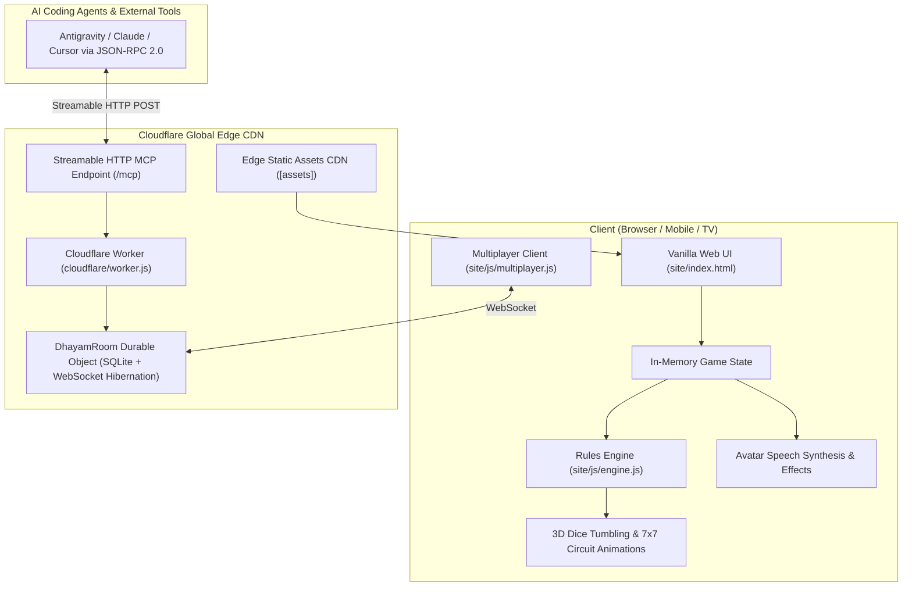

# Architecture

The application uses a zero-dependency, dual-surface architecture:
1. **Frontend App:** Pure vanilla HTML5, modular CSS3 (3D cuboidal dice physics), and ES Modules. Delivered globally via Cloudflare Edge Static Assets and mirrored on GitHub Pages.
2. **Multiplayer Backend:** Cloudflare Durable Objects with WebSocket Hibernation and SQLite persistence for state synchronization, room codes, and QR code joining at $0 cost on Cloudflare Free Tier.
3. **MCP Endpoint:** Exposed at `/mcp` for Model Context Protocol JSON-RPC tool calls, allowing AI agents to inspect board states, roll dice, and play moves.
4. **Verification & Invariant Engine:** `src/game.ts` contains an immutable TypeScript rules engine used by unit and regression test suites.

## Runtime Boundaries

- **Single Player / Local Pass-and-Play:** Self-contained in the browser tab with zero network traffic.
- **Online Multiplayer:** Orchestrated authoritatively by Cloudflare Durable Objects (`DhayamRoom`) with instant reconnects via session storage tokens.
- **MCP Server:** Streamable HTTP JSON-RPC endpoint on Cloudflare Edge at `https://dhayam.cancun.workers.dev/mcp`.
- **Primary Live URL:** `https://dhayam.cancun.workers.dev`
- **GitHub Pages Mirror:** `https://sethusrinivasan.github.io/dhayam/`
