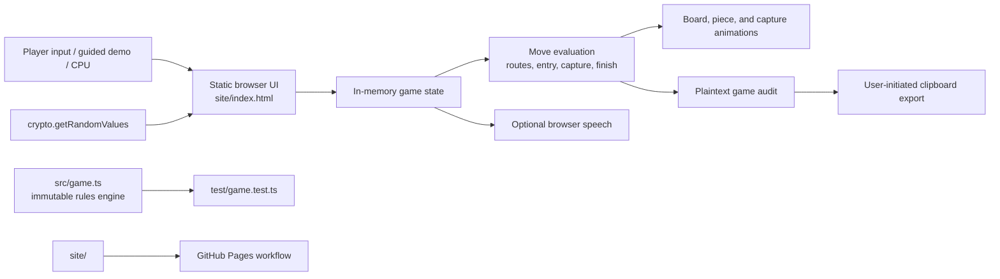

# Architecture

The browser UI is intentionally self-contained, so the game can run from static hosting without a backend. It currently contains UI-oriented rule handling. `src/game.ts` contains the dependency-free, immutable TypeScript rule engine used by the Node tests.

The migration direction is for the browser UI to consume `src/game.ts` directly. Until that is complete, rule changes must update both implementations and keep their behavior aligned.

## Runtime boundaries

- Game state exists only in the current browser tab.
- Browser APIs provide dice entropy, optional speech, and user-initiated clipboard export.
- The audit is plaintext and local until a player chooses to copy it.
- GitHub Pages serves the static `site/` directory; it is not a game server.
