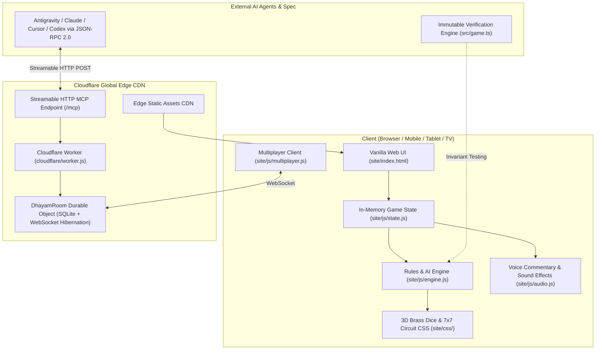

# Dhayam Architecture & Technical Design

An authentic, zero-dependency, modular web architecture designed for lifelong longevity, instant load times (<30KB gzipped), and $0 hosting cost.



---

## 1. Modular Directory Structure & Separation of Concerns

```
dhayam/
├── cloudflare/
│   ├── worker.js                  # Cloudflare Edge Worker + DhayamRoom Durable Object + MCP Endpoint
│   └── functions/mcp.js           # Cloudflare Pages / Functions adapter
├── site/                          # Pure vanilla web application (0ms cold start, <30KB gzipped)
│   ├── index.html                 # Semantic HTML markup with accessible ARIA labels
│   ├── css/                       # Modular stylesheets
│   │   ├── base.css               # Typography, design tokens, and CSS variables
│   │   ├── board.css              # 7x7 grid, cell states, progressive inner brightness, tokens
│   │   ├── dice.css               # 3D cuboidal dice transforms, faces, and rolling physics
│   │   ├── controls.css           # Turn status bar, action buttons, pool chips
│   │   ├── panels.css             # Family table, score badges, progress bars, player cards
│   │   ├── modals.css             # Splash screen, room lobby, seat picker dialogs
│   │   ├── multiplayer.css        # QR code box, live connection dots, floating reactions
│   │   ├── themes.css             # High-contrast, festive, and traditional board themes
│   │   └── responsive.css         # Tablet (860px), mobile (520px), and reduced-motion
│   └── js/                        # Single-responsibility JavaScript modules (ES Modules)
│       ├── config.js              # Board geometry constants, 44-step circuit rotation
│       ├── state.js               # Global match state, player accessors, text sanitizers
│       ├── audio.js               # Browser SpeechSynthesis commentary and interruption protection
│       ├── dice.js                # Cryptographic unbiased random dice & 3D CSS tumbling
│       ├── audit.js               # Event recorder, board snapshots, and clipboard export
│       ├── engine.js              # Move candidate validation, safe squares, and heuristic AI
│       ├── turn.js                # Synchronized turn lifecycle, animated stepping, AI scheduler
│       ├── ui.js                  # DOM renderer (cells, numbered tokens, chips, dropdowns)
│       ├── demo.js                # Interactive demo mode controller
│       ├── qrcode.min.js          # Standalone SVG QR code generator
│       ├── peerjs.min.js          # WebRTC P2P fallback library
│       ├── multiplayer.js         # Cloudflare DO WebSocket client + P2P fallback engine
│       └── app.js                 # Modal managers, player editor, keyboard nav, bootstrap
├── mcp/
│   └── server.py                  # Zero-dependency Python 3 standard library stdio MCP server
├── src/
│   └── game.ts                    # Immutable TypeScript rules engine (for headless verification)
├── test/
│   ├── game.test.ts               # Unit test suite for game rules and invariants
│   ├── multiplayer_regression.test.ts # Regression tests (48 tests passing)
│   └── mcp_server.test.ts         # Live Cloudflare-hosted MCP server JSON-RPC test suite
└── wrangler.toml                  # Cloudflare Workers + Static Assets + Durable Objects configuration
```

### Why React or Heavy Frameworks Are Not Used
* **Instant Initial Load**: Under 30KB total transfer over CDN with 0ms build/reconciliation delay.
* **60 FPS Hardware Acceleration**: 3D cuboidal dice tumbling and pawn animations use direct CSS 3D transforms without virtual DOM diffing pauses.
* **Zero Runtime Dependencies**: No npm vulnerabilities, zero maintenance burden, and decades of browser compatibility.

---

## 2. Frugal Cloudflare Hosting Architecture

Dhayam runs entirely within **Cloudflare's Free Tier** at **$0 / month**:

| Service | Cloudflare Free Allowance | Dhayam Usage |
|---|---|---|
| **Workers Static Assets** | 100,000 requests / day | Serves the static game frontend globally across 300+ Edge CDN points of presence with zero cold starts. |
| **Durable Objects (SQLite)** | 100,000 requests / day, 5 GB storage | Coordinates authoritative multiplayer room state, seat allocation, and match history with embedded SQLite persistence. |
| **WebSocket Hibernation** | 13,000 GB-seconds / day | Keeps persistent WebSockets open to all players. Automatically hibernates in memory when idle, consuming **zero compute duration** while players deliberate! |
| **Model Context Protocol (MCP)** | Included in Workers | Exposes standard Streamable HTTP MCP tools (`/mcp`) so AI coding agents can inspect board state, roll dice, and play automated matches. |

---

## 3. Real-Time Synchronization Protocol

When a room is created (e.g. `CF88`):
1. **Seat Allocation (`CLAIM_SEAT`)**: Players select open seats (N, E, S, W). A random cryptographic session token is issued and stored in browser `sessionStorage`.
2. **Synchronized Rolls (`ROLL_START`)**: When the active player rolls, the server generates the dice outcome, broadcasts `ROLL_START`, and all connected clients trigger 3D tumbling animations in unison.
3. **Synchronized Pawn Movement (`MOVE_START`)**: Pawns advance square-by-square with visual capture badge and animated flight to the family table.
4. **Authoritative State Sync (`SYNC_STATE`)**: The authoritative SQLite state guarantees no desynchronization across clients.
