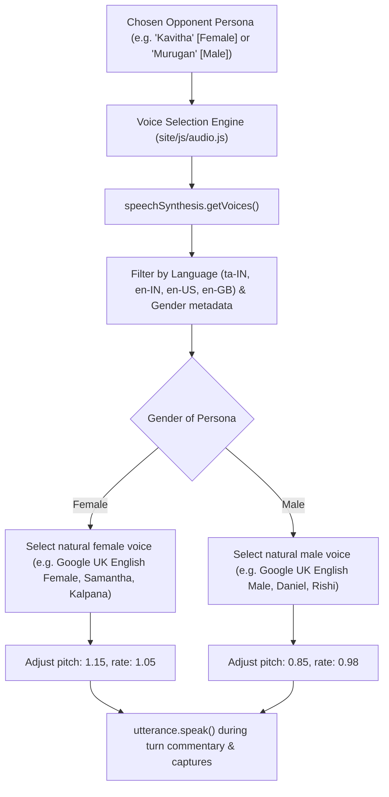
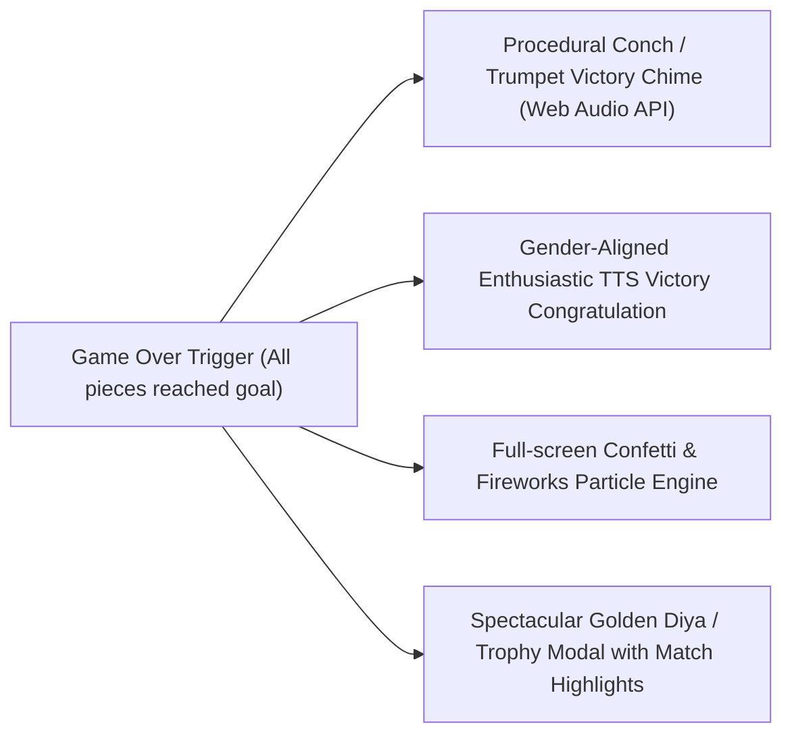

# Dynamic Personas, Localized Naming, Gender-Aligned Voice & Win Celebration Design

**Tracking issue:** [#14 — Dynamic Personas, Localized IP Naming, Gender-Aligned Voice & Spectacular Win Celebration](https://github.com/sethusrinivasan/dhayam/issues/14)

This design modernizes player identity, AI opponent variety, audio persona immersion, and game-ending celebration in Dhayam.

---

## 1. Problem Statement & Motivation

1. **Monotonous Opponent**: The default single computer name "Leo" is repetitive and lacks cultural resonance with Dhayam's traditional South Indian heritage and global players.
2. **Generic Player Naming**: Players in solo or online multiplayer currently default to "Player 1", "Player 2", or "Organizer", missing an opportunity to offer culturally authentic names based on geographic region.
3. **Voice Monotony**: Speech commentary uses a fixed default voice regardless of whether the opponent is portrayed as male, female, young, or elder.
4. **Underwhelming Finish**: When a player wins after a hard-fought 40-turn match, the current victory notification is a simple text banner, lacking the festive celebration that Dhayam traditionally embodies (conch shells, fireworks, diyas, and triumph).

---

## 2. Dynamic Computer Opponent Personas

Replace static "Leo" with an authentic, diverse roster of AI opponents spanning genders, personalities, and strategic styles:

### Female Personas
| Name | Strategy Profile | Playstyle & Commentary | Avatar / Color |
|---|---|---|---|
| **Kavitha** | Cautious / Defensive | Prioritizes safe square sanctuaries; avoids risky hops. Calm, measured voice. | 🪷 Lotus Teal |
| **Ananya** | Balanced / Strategic | Weights board advancement and track unlocking equally. Encouraging, thoughtful voice. | 🌺 Coral Gold |
| **Rani** | Aggressive / Hunter | Relentlessly hunts opponent coins; targets cutoffs. Fierce, energetic voice. | 🐆 Royal Ruby |
| **Meera** | Playful / Opportunistic | Gambles on high rolls and aggressive doubles. Lively, humorous voice. | 🦚 Peacock Blue |
| **Selvi** | Tactical / Patient | Reserves pieces until a high-value chain is rolled. Warm, patient voice. | 🌾 Emerald Green |

### Male Personas
| Name | Strategy Profile | Playstyle & Commentary | Avatar / Color |
|---|---|---|---|
| **Murugan** | Wise / Elder | Classic traditional playstyle; values reserve preservation. Deep, calm voice. | 🪔 Golden Diya |
| **Kavin** | Speedy / Sprinter | Pushes forward runner pieces as fast as possible to center goal. Fast, brisk voice. | ⚡ Amber Solar |
| **Arjun** | Bold / Challenger | Aggressive center-track blockades and bold maneuvers. Confident, resonant voice. | 🏹 Crimson Flame |
| **Mani** | Tenacious / Counter-Attacker | Patient in outer circuit, lethal when counter-attacking. Sharp, spirited voice. | 🐅 Copper Bronze |
| **Vikram** | Relentless / Analytical | High-heuristic minimax evaluation; optimizes finish probability. Focused, deliberate voice. | 🦅 Sapphire Blue |

### Engine Integration
When starting a Solo match (`newGame(2, 1)`):
- Randomly select an opponent persona from the roster (or allow player selection via dropdown in New Game modal).
- Inject the persona's heuristic weights into `site/js/engine.js:evaluate_moves()`:
  - `safetyBias`: Multiplier for landing on castle/safe squares.
  - `aggressionBias`: Multiplier for capturing enemy coins.
  - `progressBias`: Multiplier for advancing tokens toward the center home goal.

---

## 3. Localized Player Naming via Connected IP / Region

When initiating a match or multiplayer lobby:
1. Detect player's region via Cloudflare edge headers (`CF-IPCountry`, `CF-RegionCode`, `cf.timezone`) or browser `Intl.DateTimeFormat().resolvedOptions().timeZone`:
   - **South Asia / Tamil Nadu (`IN-TN`, `Asia/Kolkata`)**: Seed from Tamil / Indian name bank (*Aarav, Diya, Kavin, Ananya, Murugan, Priya, Thilak, Selvi, Ashwin, Nithya*).
   - **Southeast Asia / Sri Lanka / Singapore / Malaysia**: Seed from diaspora heritage names (*Siva, Malar, Kumaran, Geetha, Dinesh*).
   - **Americas / Europe / Global**: Offer globally recognized, authentic names or localized cultural variants.
2. **Organizer / User Override**: Users can always edit player names in the UI.
3. **Security Invariant**: Strictly escape any organizer-provided or network-provided name before inserting into HTML DOM to prevent XSS (mandated by `AGENTS.md`).

---

## 4. Gender-Aligned Voice Synthesis (`site/js/audio.js`)

Leverage Web Speech API (`window.speechSynthesis`) to match the chosen opponent:

---

## 5. Spectacular Win Celebration

When a player wins (`winner !== null`):

### Components of the Celebration:
1. **Procedural Victory Fanfare**:
   - Synthesize a traditional Indian victory fanfare using Web Audio API:
     - Ascending conch shell frequency sweep (*Shankha* resonance).
     - Rhythmic celebration drum roll (*Mridangam* / *Thavil* rhythmic beat).
     - Bright brass chime chords.
2. **Full-Screen Confetti & Fireworks Canvas (`site/js/confetti.js`)**:
   - High-performance, zero-dependency particle engine rendering confetti ribbons, sparkling gold diyas, and firework bursts.
   - Automatically pauses after 6 seconds or on modal dismissal to conserve battery.
   - Respects `prefers-reduced-motion` by substituting with a static glowing festive laurel wreath.
3. **Dynamic Victor Proclamation Modal**:
   - Displays champion avatar, golden illuminated trophy, and winner name in vibrant festive typography.
   - Highlights match achievements:
     - *"🎯 Accuracy: X legal moves executed flawlessly"*
     - *"⚔️ Battles Won: Y opponent captures"*
     - *"🌟 Score: Z points achieved in N turns"*
   - Buttons: *"Play Rematch"* & *"Share Victory Card / QR"*.
4. **Spoken Congratulation**:
   - The selected opponent persona gracefully concedes and enthusiastically congratulates the winner via speech synthesis:
     - e.g. *"Magnificent game, Aarav! You have mastered the four brass dice of Dhayam! All hail the champion!"*

---

## 6. Acceptance Criteria

- [ ] Static "Leo" replaced with at least 10 varied female and male computer personas.
- [ ] Opponent persona selection includes unique avatars and strategy profiles.
- [ ] Localized player names suggested dynamically based on timezone/GeoIP.
- [ ] All player names rigorously escaped before DOM insertion.
- [ ] Speech commentary dynamically selects female vs male voices matching opponent persona gender.
- [ ] Procedural victory fanfare (conch/trumpet) synthesized via Web Audio API.
- [ ] Zero-dependency canvas confetti/fireworks celebration triggers on victory.
- [ ] Reduced-motion mode respected.
- [ ] Victory modal summarizes player highlights, score, and shareable QR.
