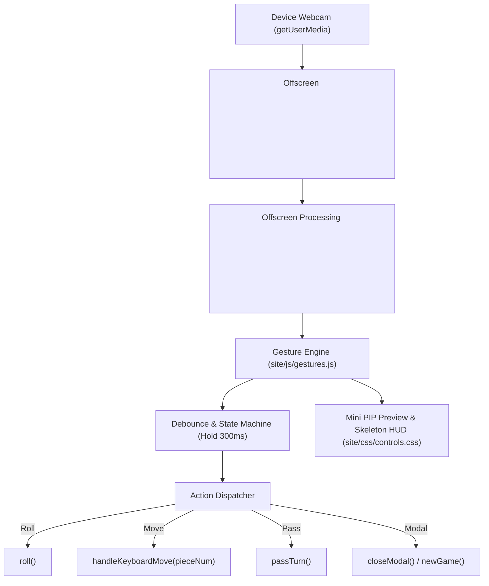

# Camera-Based Hand Gesture Tracking Design

**Tracking issue:** [#13 — Camera Hand Gesture Tracking: Touchless game controls via webcam gesture recognition](https://github.com/sethusrinivasan/dhayam/issues/13)

Dhayam already supports mouse, multi-touch, keyboard navigation (Space, R, M, 1–6, N, Esc), and voice command recognition. This design defines an optional **touchless, camera-driven gesture control system** that lets players control the board using hand gestures captured by their device's webcam.

---

## 1. Objectives & Principles

1. **Strictly Optional & Opt-in**: The camera is never accessed by default. Users must explicitly enable gesture tracking in the Settings modal ("Enable Camera Hand Gestures").
2. **100% On-Device Privacy**: No video frames or biometric data ever leave the client browser. Video processing runs entirely client-side via lightweight HTML5 `<video>`, `<canvas>`, and WebAssembly / MediaPipe Hands models.
3. **Low Latency & High Responsiveness**: Gesture detection cycle runs at 15–30 FPS with negligible CPU impact (<8% CPU on modest hardware).
4. **Resilience & Fallback**: If lighting is poor, hand is occluded, or camera is unavailable, keyboard, voice, and mouse controls remain fully responsive in parallel.
5. **Clear Visual Feedback**: A non-intrusive PIP (picture-in-picture) mini-feed with an active gesture skeleton overlay and detection indicator (e.g. "✊ Closed Fist", "🖐 Open Hand: Roll", "☝ Point 1: Piece 1").

---

## 2. Gesture Mapping Table

| Physical Gesture | Game Action | Trigger Condition |
|---|---|---|
| **Fist to Open Palm (Throw motion)** | **Roll Dice (`roll()`)** | Hand transitions rapidly from closed fist (✊) to open palm (🖐) forward, or a rapid wrist flick. |
| **Finger Count (1 to 6)** | **Select Piece 1–6 (`movePiece(pieceNum)`)** | Raised fingers (1 = Index, 2 = Index+Middle, etc.) matching player's piece numbers on board. |
| **Index Point & Tap / Pinch** | **Move / Confirm Action** | Index finger pointing directly at the desired board square or pinch gesture (Index + Thumb tap). |
| **Horizontal Palm Swipe / Wave** | **Pass Turn / Dismiss Modal** | Hand moving quickly left-to-right across camera viewport when no legal moves remain or modal is open. |
| **Thumbs Up (👍)** | **Confirm / New Game** | Hold thumbs up for 1.2s to start a new game or confirm prompt. |

---

## 3. Architecture & Media Pipeline

---

## 4. Privacy, Security & CSP Considerations

- **Permissions-Policy**: Update `site/_headers` to allow `camera=(self)` when gesture mode is active (or user-initiated).
- **Stream Teardown**: When the user closes the game or toggles gestures off in Settings, every `MediaStreamTrack` is explicitly invoked with `track.stop()`, turning off the webcam indicator light immediately.
- **No Remote Telemetry**: Camera frames are never passed to FlightRecorder, Cloudflare Durable Objects, or external analytics.
- **Storage**: User toggle preference is saved in `localStorage.getItem('dhayam_gesture_controls_enabled')`.

---

## 5. Acceptance Criteria

- [ ] "Camera Hand Gestures" toggle added in Settings modal (default: off).
- [ ] Explicit permission prompt with explanation before camera access.
- [ ] Open hand flick reliably triggers dice roll.
- [ ] Numbered finger gestures (1–4 / 1–6) select corresponding legal pieces.
- [ ] Mini HUD displays detected gesture name and visual feedback.
- [ ] Toggling off immediately cuts camera stream and releases hardware.
- [ ] Zero interference with existing keyboard, voice, and mouse interactions.
