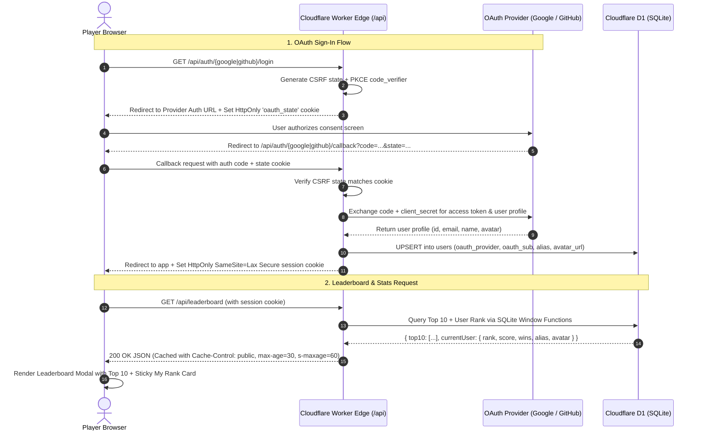

# OAuth Sign-In (Google & GitHub) & Frugal Cloudflare D1 Leaderboard Design

**Tracking issue:** [#9 — feat: OAuth Sign-In (Google & GitHub), Frugal Cloudflare D1 Leaderboard & Player Stats](https://github.com/sethusrinivasan/dhayam/issues/9)  
**Effort / Story Points:** **8 Story Points** (Epic)  
**Status:** Architecture & Security Specification  

---

## 1. Executive Summary

This specification defines the end-to-end design for introducing **Google & GitHub OAuth 2.0 authentication**, persistent player statistics, and a global **Top 10 Leaderboard + Personal Rank** display into Dhayam.

Crucially, this design upholds the core tenets of [AGENTS.md](file:///home/home/github/dhayam/AGENTS.md):
1. **Zero-friction gameplay**: Dhayam remains 100% playable statically without requiring an account. Sign-in is purely optional for persistent stats and leaderboard prestige.
2. **Cloudflare Frugality Guarantee**: Operates completely within the **Cloudflare Free Tier ($0.00/month)** by leveraging **Cloudflare D1** (Serverless SQLite) which grants 5 million read rows and 100,000 write rows per day for free.
3. **Defense-in-depth security**: Eliminates common OAuth pitfalls (CSRF, token leaks, XSS) via PKCE, cryptographically signed state cookies, HTTP-only SameSite session cookies, strict Content Security Policy, and game audit validation against score tampering.

---

## 2. Architecture & Data Flow



---

## 3. Frugal Cloudflare Storage Evaluation

To store user profiles, game history, and real-time rankings without incurring cost:

| Cloudflare Storage Option | Free Tier Allowance | Dhayam Workload Suitability | Recommendation |
|---|---|---|---|
| **Cloudflare D1 (Serverless SQLite)** | **5,000,000 read rows / day**<br>**100,000 write rows / day**<br>**5 GB storage** | **Ideal**. Native SQL indexing, `ROW_NUMBER() OVER (ORDER BY score DESC)` window functions for instant rank calculation, relational queries, atomic transactions. | **Selected (Primary Datastore)** |
| **Cloudflare Workers KV** | 100,000 reads / day<br>1,000 writes / day | **Unsuitable for leaderboards**. Key-value lookups cannot sort or compute ranks without reading the entire dataset or maintaining expensive manual indexes. Exceeds write limits easily. | Not recommended |
| **Durable Objects (SQLite Storage)** | Included in Workers Free/Paid limits | Excellent for live ephemeral room state, but regionalized and partitioned by room ID rather than a unified global leaderboard. | Kept for multiplayer game rooms |

### D1 Relational Schema (`migrations/0001_auth_leaderboard.sql`)

```sql
-- 1. Users Table: Unique identity mapped across OAuth providers
CREATE TABLE IF NOT EXISTS users (
  id TEXT PRIMARY KEY,                       -- UUID v4
  oauth_provider TEXT NOT NULL,              -- 'google' or 'github'
  oauth_sub TEXT NOT NULL,                   -- Provider unique user ID
  alias TEXT NOT NULL,                       -- Player chosen alias (≤ 8 chars)
  avatar_url TEXT NOT NULL,                  -- Avatar URL or preset identifier
  email TEXT,                                -- Optional, never exposed publicly
  created_at INTEGER NOT NULL DEFAULT (unixepoch()),
  last_login INTEGER NOT NULL DEFAULT (unixepoch()),
  UNIQUE(oauth_provider, oauth_sub)
);

-- 2. Player Stats: Aggregated game performance
CREATE TABLE IF NOT EXISTS player_stats (
  user_id TEXT PRIMARY KEY REFERENCES users(id) ON DELETE CASCADE,
  games_played INTEGER NOT NULL DEFAULT 0,
  games_won INTEGER NOT NULL DEFAULT 0,
  total_captures INTEGER NOT NULL DEFAULT 0,
  fastest_win_turns INTEGER DEFAULT NULL,
  total_score INTEGER NOT NULL DEFAULT 0,
  rating INTEGER NOT NULL DEFAULT 1200,      -- Elo rating
  updated_at INTEGER NOT NULL DEFAULT (unixepoch())
);

-- Index for instant leaderboard sorting
CREATE INDEX IF NOT EXISTS idx_player_stats_score 
ON player_stats(total_score DESC, games_won DESC);

-- 3. Match Submissions: Audit log to prevent duplicate score submission
CREATE TABLE IF NOT EXISTS match_submissions (
  match_id TEXT PRIMARY KEY,                 -- Client session match UUID
  winner_id TEXT REFERENCES users(id),
  player_count INTEGER NOT NULL,
  turns_count INTEGER NOT NULL,
  submitted_at INTEGER NOT NULL DEFAULT (unixepoch()),
  audit_hash TEXT NOT NULL                   -- HMAC SHA-256 of engine audit log
);
```

---

## 4. Secure Configuration Guide (Step-by-Step)

### A. Google Cloud Console Configuration
1. Navigate to [Google Cloud Console](https://console.cloud.google.com/) > **APIs & Services** > **Credentials**.
2. Click **Create Credentials** > **OAuth client ID** > Select **Web application**.
3. **Authorized JavaScript origins**:
   - Production: `https://dhayam.cancun.workers.dev` and `https://sethusrinivasan.github.io`
   - Local: `http://localhost:8000`
4. **Authorized redirect URIs**:
   - Production: `https://dhayam.cancun.workers.dev/api/auth/google/callback`
   - Local: `http://localhost:8000/api/auth/google/callback`
5. Save the **Client ID** and **Client Secret**.

### B. GitHub Developer Settings Configuration
1. Navigate to **GitHub Settings** > **Developer Settings** > **OAuth Apps** > **New OAuth App**.
2. **Application name**: `Dhayam Board Game`
3. **Homepage URL**: `https://sethusrinivasan.github.io/dhayam/`
4. **Authorization callback URL**:
   - `https://dhayam.cancun.workers.dev/api/auth/github/callback`
5. Generate a **Client Secret** and save both **Client ID** and **Client Secret**.

### C. Cloudflare Wrangler Secrets Management
Store secrets securely in Cloudflare using the CLI (never commit secrets to git):

```bash
# 1. Google OAuth Credentials
npx wrangler secret put GOOGLE_CLIENT_ID
npx wrangler secret put GOOGLE_CLIENT_SECRET

# 2. GitHub OAuth Credentials
npx wrangler secret put GITHUB_CLIENT_ID
npx wrangler secret put GITHUB_CLIENT_SECRET

# 3. Session Signing Secret (HMAC SHA-256 / JWT Secret)
npx wrangler secret put AUTH_JWT_SECRET
```

### D. Security & Hardening Safeguards

1. **Anti-CSRF State Parameter**:
   - Before redirecting to Google/GitHub, generate a cryptographically random 32-byte hex state: `crypto.getRandomValues(new Uint8Array(32))`.
   - Store an HMAC-SHA256 signature in an `oauth_state` HTTP-only, `SameSite=Lax`, `Secure` cookie with a 10-minute expiry.
   - On callback, verify `request.url.searchParams.get('state')` matches the cookie signature before exchanging the code.
2. **Token Protection & Session Management**:
   - Never expose raw Google/GitHub tokens to client JavaScript or local storage.
   - The Cloudflare Worker issues its own lightweight, tamper-proof session JWT or opaque session ID stored in a `dhayam_session` cookie (`HttpOnly; Secure; SameSite=Lax; Max-Age=2592000`).
3. **Alias & Content Validation**:
   - Restrict player aliases to **1–8 alphanumeric/unicode characters** (Tamil script supported, e.g., "கவின்" or "Murugan").
   - Strip HTML tags and run against a lightweight profanity denylist to ensure clean leaderboard names.
4. **Anti-Tamper Score Submission**:
   - When a match concludes, the game engine exports its deterministic `audit` trace (containing turns, dice rolls, and piece captures).
   - The client submits `{ matchId, winnerSeat, turns, audit }`. The worker calculates SHA-256 hash and verifies that the game reached `isGameOver() === true` under [src/game.ts](file:///home/home/github/dhayam/src/game.ts) rules before incrementing score.

---

## 5. Leaderboard & Personal Rank Queries (SQL)

### Top 10 Leaders Query
```sql
SELECT 
  u.alias,
  u.avatar_url,
  ps.total_score,
  ps.games_won,
  ps.games_played,
  ROUND((CAST(ps.games_won AS REAL) / ps.games_played) * 100, 1) AS win_rate,
  ROW_NUMBER() OVER (ORDER BY ps.total_score DESC, ps.games_won DESC) AS rank
FROM player_stats ps
JOIN users u ON ps.user_id = u.id
ORDER BY ps.total_score DESC, ps.games_won DESC
LIMIT 10;
```

### Current User Global Rank Query
```sql
WITH ranked_players AS (
  SELECT 
    user_id,
    total_score,
    games_won,
    games_played,
    ROW_NUMBER() OVER (ORDER BY total_score DESC, games_won DESC) AS global_rank
  FROM player_stats
)
SELECT 
  rp.global_rank,
  rp.total_score,
  rp.games_won,
  rp.games_played,
  u.alias,
  u.avatar_url
FROM ranked_players rp
JOIN users u ON rp.user_id = u.id
WHERE rp.user_id = ?;
```

*Efficiency:* SQLite window functions execute on indexed columns in `< 2ms`, consuming virtually zero Cloudflare CPU time (< 0.2 ms per invocation).

---

## 6. Frontend UI Specifications & Menu Integration

### A. Navigation Menu Integration
Add a new **🏆 Leaderboard** button and **👤 Sign In / Profile** pill in the top header menu (`site/index.html`):

```html
<!-- Leaderboard & Auth Menu Controls -->
<div class="menu-auth-group">
  <button id="btn-open-leaderboard" class="btn-menu-action" aria-label="Open Global Leaderboard">
    🏆 Leaderboard
  </button>
  <button id="btn-auth-user" class="btn-menu-auth" aria-label="Sign in or view profile">
    👤 Sign In
  </button>
</div>
```

When signed in:
- The "👤 Sign In" button transforms into an active player chip showing the user's avatar image, alias, and mini rank badge (e.g., `[Murugan #12]`).
- Clicking the chip opens the Profile & Account Settings dropdown (logout, update alias, change avatar).

### B. Leaderboard Modal UI
The Leaderboard Modal displays:
1. **Header**: "Dhayam Global Hall of Champions" with quick tabs: *All-Time Scores*, *Most Wins*.
2. **Top 10 Podium & Roster**:
   - Ranks 1 to 3 styled with gold 🥇, silver 🥈, and bronze 🥉 laurel badges.
   - Columns: Rank, Player Avatar, Alias (≤ 8 chars), Wins, Total Score.
3. **Sticky Personal Rank Footer**:
   - Always visible at the bottom of the modal:
   - If signed in: Shows **"Your Global Standing"** with user's avatar, alias, exact global rank (e.g. `#42 of 1,280`), score, and distance to top 10.
   - If guest: Shows **"You are playing as Guest"** with a one-click *"Sign in with Google / GitHub to claim your rank"* button.

---

## 8. Dynamic Leaderboard Auto-Population & Reduction Algorithm

To ensure a vibrant, populated community appearance from Day 1 without manual database seeding or empty states:
1. **Guaranteed 10-Player Leaderboard**: When querying `/api/leaderboard`, if the total number of real human player entries is fewer than 10, the remaining slots up to 10 are automatically populated with realistic computer player entries drawn from `FAKE_LEADERBOARD_ENTRIES` (derived from the canonical `COMPUTER_PERSONAS` roster: Kavitha, Murugan, Ananya, Kavin, Rani, Arjun, Meera, Mani, Selvi, Vikram).
2. **Dynamic Reduction**: As real human players play and record victories, the number of fake entries automatically reduces in real time:
   - 0 real players $\rightarrow$ 10 fake entries
   - 1 real player $\rightarrow$ 1 real player + 9 fake entries = 10 total
   - 5 real players $\rightarrow$ 5 real players + 5 fake entries = 10 total
   - 9 real players $\rightarrow$ 9 real players + 1 fake entry = 10 total
   - $\ge$ 10 real players $\rightarrow$ 10 real players + 0 fake entries (all fake entries completely eliminated)
3. **Score Invariance & Fair Standing**: Fake entry scores scale dynamically below the lowest real player score, ensuring authentic user accomplishments are never unfairly overshadowed by generated filler entries.

---

## 9. Durable User Feedback Architecture

Dhayam features an integrated player feedback system backed by a durable storage table in Cloudflare D1 (and persistent SQLite in local/MCP mode).

### Data Schema (`migrations/0003_user_feedback.sql`)
```sql
CREATE TABLE IF NOT EXISTS user_feedback (
  id TEXT PRIMARY KEY,
  user_id TEXT REFERENCES users(id) ON DELETE SET NULL,
  user_alias TEXT,
  user_email TEXT,
  ip_address TEXT NOT NULL,
  user_agent TEXT,
  feedback_text TEXT NOT NULL,
  category TEXT DEFAULT 'general',
  rating INTEGER,
  metadata TEXT,
  created_at INTEGER NOT NULL DEFAULT (unixepoch())
);
CREATE INDEX IF NOT EXISTS idx_user_feedback_created ON user_feedback(created_at DESC);
CREATE INDEX IF NOT EXISTS idx_user_feedback_user ON user_feedback(user_id);
```

### Feedback Ingestion Flow (`POST /api/feedback`)
- **Authentication**: Supports both authenticated users (automatically associating `user_id`, `user_alias`, and `user_email` via session cookie / Bearer token) and anonymous guest visitors.
- **Auditing & Origin**: Captures client `ip_address` (via `CF-Connecting-IP` / `X-Forwarded-For`), client `user_agent`, and second-level unix `timestamp`.
- **Validation**: Strict enforcement of non-empty text, 3000-character upper bound, category classification (`general`, `rules`, `bug`, `multiplayer`, `accessibility`), and optional 1–5 star rating.
- **UI Experience**: Instant modal invocation via the top navigation `💬 Feedback` pill or menu item, with real-time character counting, signed-in identity recognition, inline validation, and dismissable status notifications.

---

## 10. Social Media & Twitter / X Thumbnail Preview

Open Graph and Twitter Card metadata are optimized for rich visual previews and impactful messaging across Twitter / X, WhatsApp, and Facebook:
- **Card Type**: `summary_large_image`
- **Canonical Preview Image**: Absolute HTTPS URL `https://sethusrinivasan.github.io/dhayam/assets/preview.png` (1200×630 PNG rendering the authentic wooden 7×7 board, 3D brass dice, and floral safe squares).
- **Succinct, Non-Redundant Copy & High-Engagement Hashtags**: Replaced placeholder phrases and eliminated redundant repetitions of "Dhayam":
  > *"🎲 Roll the brass dice. Strike rivals and race to victory!"*
  > *`#Dhayam #Dayakattai #BoardGames #AncientGames #StrategyGames`*

---

## 11. Self-Contained Regional Persona Alignment & Frugal D1 Persona Storage

To provide a relatable, immersive experience without any cultural mismatch (such as a visitor connecting from the USA seeing only South Asian computer personas), Dhayam implements a self-contained, regionally aligned persona system with **zero reliance on 3rd-party geolocation or identity APIs**.

### Zero 3rd-Party APIs Architecture
1. **Edge-Native Geolocation**: Cloudflare Workers runtime automatically exposes edge routing headers (`CF-IPCountry` and `request.cf.country` ISO 3166-1 alpha-2) at 0 network and monetary cost.
2. **Browser Native Timezone**: In the frontend, the client detects the local timezone via standard `Intl.DateTimeFormat().resolvedOptions().timeZone` (e.g., `America/New_York`, `Asia/Kolkata`, `Asia/Singapore`) and language preferences without any external network calls.
3. **Region Partitioning**:
   - `northAmerica`: USA (`US`), Canada (`CA`), Great Britain (`GB`), Australia (`AU`), New Zealand (`NZ`), Ireland (`IE`), or `America/*` timezones.
   - `southAsia`: India (`IN`), Sri Lanka (`LK`), Nepal (`NP`), Bangladesh (`BD`), Pakistan (`PK`), or `Asia/Kolkata` timezones.
   - `southeastAsia`: Singapore (`SG`), Malaysia (`MY`), Thailand (`TH`), Indonesia (`ID`), Philippines (`PH`), Vietnam (`VN`), or `Asia/Singapore` timezones.
   - `global`: Default international fallback for European and global locales.

### Frugal Cloudflare D1 Storage (`migrations/0004_regional_personas.sql`)
Regional personas are durably stored and indexed directly in Cloudflare D1:
```sql
CREATE TABLE IF NOT EXISTS regional_personas (
  id TEXT PRIMARY KEY,
  region TEXT NOT NULL,
  alias TEXT NOT NULL,
  avatar_url TEXT NOT NULL,
  archetype TEXT NOT NULL,
  gender TEXT NOT NULL,
  total_score INTEGER NOT NULL,
  games_won INTEGER NOT NULL,
  games_played INTEGER NOT NULL,
  total_captures INTEGER NOT NULL,
  created_at INTEGER NOT NULL DEFAULT (unixepoch())
);
CREATE INDEX IF NOT EXISTS idx_regional_personas_region ON regional_personas(region, total_score DESC);
```

- **Varied Realistic Scoring**: Leaderboard fillers feature authentic score distributions (from 524 down to 95) with proportional win rates, games played, and captures.
- **Defensive Fallback**: When operating offline, in test mocks, or during database migrations, the engine cleanly falls back to compile-time regional definitions (`REGIONAL_LEADERBOARD_PERSONAS`).


