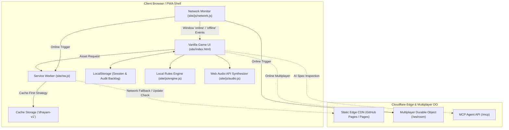
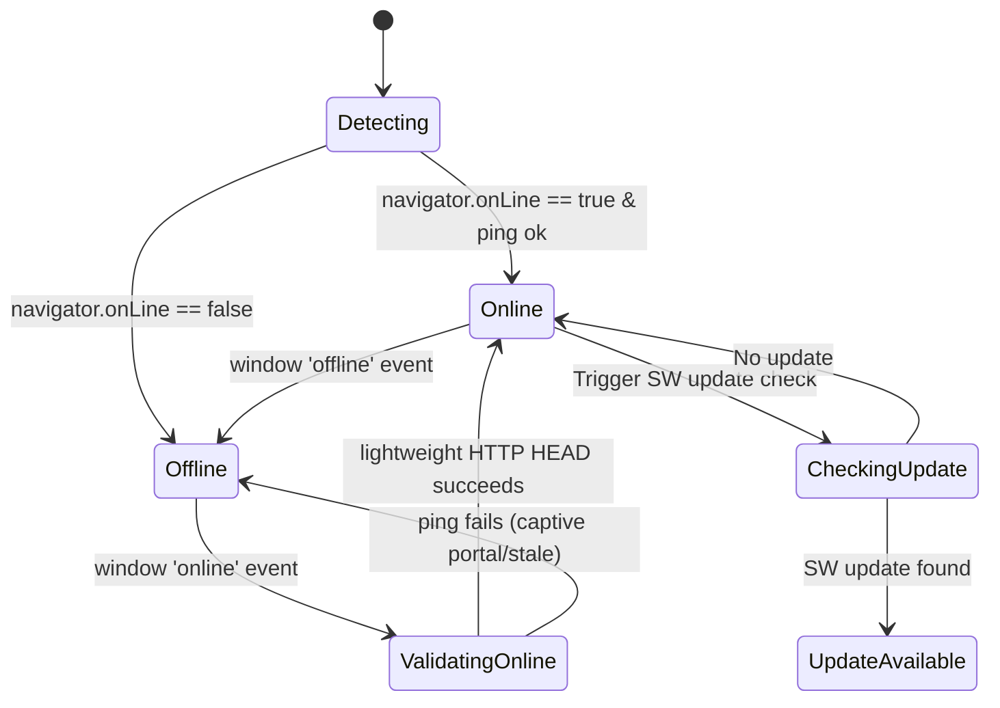
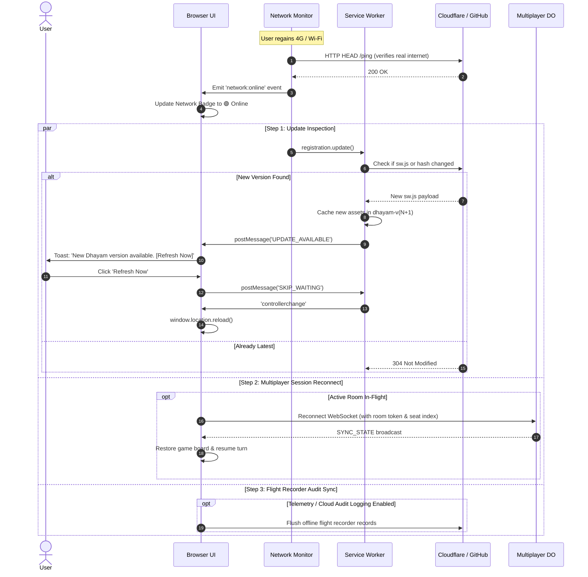

# Offline Mode & Progressive Web App (PWA) Design

**Tracking issue:** [#12 — Offline PWA Mode: Zero-connectivity gameplay with automatic background refresh & sync](https://github.com/sethusrinivasan/dhayam/issues/12)

Dhayam is a zero-dependency, static board game built on clean web fundamentals. While its core rules engine and audio synthesizer operate locally in the browser, opening the game currently requires active internet connectivity. 

This document defines the architectural design, security analysis, lifecycle mechanics, and implementation plan for running Dhayam **100% offline** with zero internet connectivity, paired with an **automatic refresh and synchronization protocol** when network connectivity is restored.

---

## 1. Executive Summary & Objectives

### Goals
1. **Zero-Connectivity First Load**: Once visited or installed (PWA), Dhayam must launch instantly (<100ms) with zero network connectivity.
2. **Complete Offline Gameplay**: Solo vs. Computer (all AI personas), Local Pass & Play (2–4 players), and offline replay/audit functions must execute without network calls.
3. **Hardware Entropy Offline**: Dice generation must continue to use `crypto.getRandomValues()` locally without compromising fair-play invariants.
4. **Network Detection & Graceful Degradation**: Real-time detection of offline/online transitions with visual UI badging and non-blocking disabling of remote multiplayer features.
5. **Smart Background Refresh on Network Return**:
   - When the client transitions back online, automatically probe server health.
   - Check for new application revisions and rules updates via Service Worker lifecycle.
   - Offer a seamless non-destructive update refresh ("Update Available — Click to Refresh").
   - Automatically reconnect in-flight multiplayer sessions if a room was disconnected during a transient signal drop.
6. **Zero External Dependencies**: Implemented strictly in vanilla JavaScript, Cache Storage API, and Web Standards without third-party bundlers or runtime bloat.

---

## 2. Architecture & Component Workflow



---

## 3. Detailed Component Design

### 3.1 Service Worker & Cache Hierarchy (`site/sw.js`)

The service worker implements an **App Shell Pre-cache** and a **Stale-While-Revalidate** caching strategy:

```javascript
const CACHE_NAME = 'dhayam-v0.4.0';

const PRECACHE_ASSETS = [
  './',
  './index.html',
  './_headers',
  './board-definition-v1-candidate.json',
  // CSS Modules
  './css/base.css',
  './css/board.css',
  './css/controls.css',
  './css/dice.css',
  './css/modals.css',
  './css/multiplayer.css',
  './css/panels.css',
  './css/responsive.css',
  './css/themes.css',
  './css/embed.css',
  // JS Modules
  './js/app.js',
  './js/audio.js',
  './js/audit.js',
  './js/config.js',
  './js/demo.js',
  './js/dice.js',
  './js/embed-host.js',
  './js/engine.js',
  './js/multiplayer.js',
  './js/peerjs.min.js',
  './js/qrcode.min.js',
  './js/recorder.js',
  './js/state.js',
  './js/themes.js',
  './js/turn.js',
  './js/ui.js',
  './js/voice.js',
  './js/network.js',
  // Visual Assets
  './assets/preview.png',
  './assets/qr-dhayam.svg',
  './manifest.webmanifest'
];
```

#### Caching Strategies:
1. **Static App Shell**: Cache-first with background cache invalidation on new service worker version activation.
2. **Dynamic / Multiplayer WebSocket Calls (`wss://...`, `/mcp`, `/health`)**: Network-only; bypass Service Worker cache entirely.
3. **Offline Fallback**: When an uncached document request fails offline, serve the pre-cached `index.html`.

### 3.2 Web App Manifest (`site/manifest.webmanifest`)
Provides full PWA installation capability on Android, iOS Safari (PWA standalone), ChromeOS, and Desktop:
- `display: standalone`
- `theme_color: #1a0f07`
- `background_color: #0d0804`
- `icons`: 192x192 and 512x512 adaptive SVG / PNG icons.
- `orientation`: `any` (responsive layout handles portrait mobile and widescreen desktop).

### 3.3 Network Sensor & State Machine (`site/js/network.js`)

A dedicated lightweight network state observer tracks connectivity:



#### Responsibilities:
- Emits custom events: `network:online`, `network:offline`, `app:updateavailable`.
- Provides `isOnline()` boolean query.
- Validates real internet connectivity using a fast HTTP HEAD probe with 2.5s timeout (preventing false "online" state on captive Wi-Fi or router login portals).

### 3.4 Mode Degradation Matrix

| Feature | Online | Offline | Behavior When Offline |
|---|---|---|---|
| **Solo vs Computer** | Full | Full | 100% functional. AI heuristic minimax runs locally in JS. |
| **Pass & Play (Local)** | Full | Full | 100% functional. 2–4 players share the screen. |
| **Guided Demo** | Full | Full | 100% functional in local simulation mode. |
| **Voice Commands & TTS** | Full | Partial | Web Speech API voice synthesis functions offline if device OS has local voice pack. Speech recognition displays fallback notice if cloud STT engine is unavailable. |
| **Sound FX** | Full | Full | Web Audio API synthesizes square-wave / sine tones procedurally; zero audio asset dependencies. |
| **Dice Rolling** | Full | Full | `crypto.getRandomValues()` runs natively on local CPU entropy. |
| **Audit Log & Flight Recorder** | Full | Full | Persisted locally in `localStorage` / memory. |
| **Multiplayer (Cloudflare DO)** | Full | Disabled | Lobby shows: "Multiplayer unavailable offline". Re-enables automatically upon reconnect. |

---

## 4. Reconnection & Online Refresh Protocol

When the network transitions from `offline` to `online`, the application executes a coordinated 4-step recovery:



### 4.1 Non-Destructive Update Strategy
Crucially, if a user is in the middle of an intense local game, the application **must not abruptly reload the page**. 
Instead:
- The updated assets are cached in the background.
- A discrete banner or toast notifies the player: *"Dhayam updated. [Refresh to apply]"*.
- If the game completes or the player starts a new game, the reload can be triggered smoothly.

---

## 5. Security & Threat Modeling

1. **Content Security Policy (`site/_headers`)**:
   - Add `worker-src 'self'` to the CSP directive.
   - Maintain `script-src 'self' 'unsafe-inline'` without external scripts.
2. **Cache Poisoning Resistance**:
   - The Service Worker only caches assets from `'self'` origin.
   - External URLs or arbitrary user inputs are rejected from being written into Cache Storage.
3. **Fairness Invariance**:
   - Offline play uses the identical `engine.js` and `crypto.getRandomValues()` routines as online play.
   - No external timestamp tampering is permitted to influence dice seeding.
4. **Storage Quota & Privacy**:
   - The entire pre-cache is under 1.5MB total (board definitions, JS, CSS, and minimal SVG).
   - No sensitive PII is ever stored in `localStorage` or Service Worker cache.

---

## 6. Verification & Test Plan

1. **Service Worker Unit & Syntax Tests**:
   - Add Node.js test in `test/service_worker.test.ts` to validate syntax, precache asset resolution, and cache-header contracts.
2. **Offline Acceptance Simulation via Headless Chrome**:
   - Automate Chrome DevTools Protocol (CDP) `Network.emulateNetworkConditions({ offline: true })`.
   - Verify that loading `site/index.html` succeeds with zero network calls and full dice rolling functionality.
3. **Online/Offline Event Transitions**:
   - Dispatch synthetic `online` and `offline` Window events.
   - Verify UI updates network indicator badge, disables multiplayer controls gracefully, and recovers without unhandled rejections.
4. **Coverage Maintenance**:
   - Maintain `npm test` and `npm run test:coverage` above the repository threshold (>95%).
